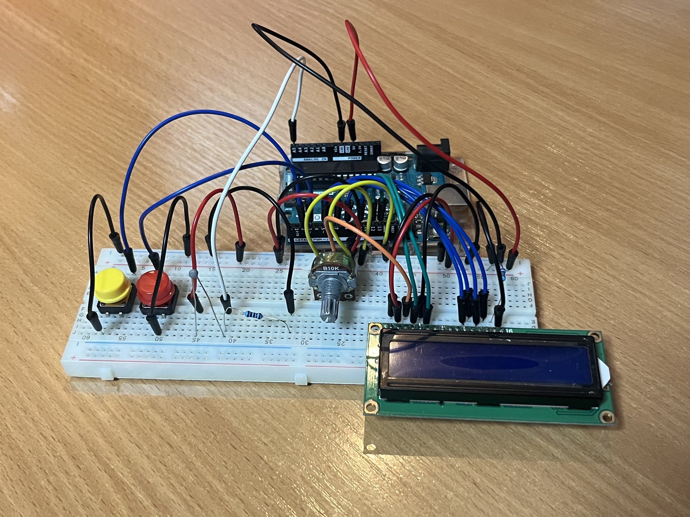
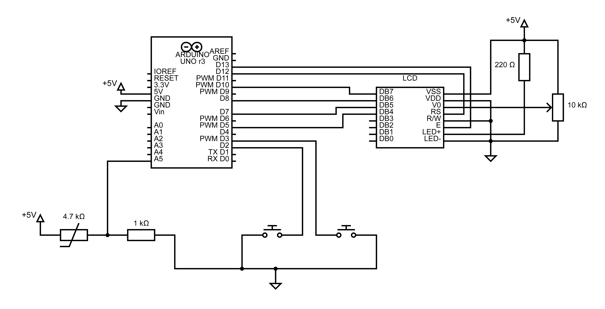

# Įvado į robotiką antrasis projektas

## Aprašymas
Projekte įgyvendintas termometras, galintis vaizduoti dabartinę temperatūrą ir atmintyje saugantis aukščiausią bei žemiausią aptiktą temperatūrą. Mygtukas A leidžia keisti sensorių tarp dviejų režimų: 1 - dabartinės temperatūros rodymas, 2 - aukščiausios ir žemiausios temperatūros rodymas. Mygtukas B 1 režime leidžia keisti temperatūros skalę tarp Celsijaus ir Farenheito, 2 režime ištrina aukščiausią ir žemiausią temperatūras iš atminties. Informacija vaizduojama LCD ekrane, kurio ryškumas valdomas potenciometru.

## Nuotrauka

## Schema

## Temperatūros matavimas
Temperatūrai matuoti naudojamas 4.7K omų NTC termistorius su įtampos dalikliu. Temperatūra gaunama naudojant įtampos daliklio išėjimo įtampos bei beta-parametro formules. Kode galima nustatyti konstantas `nominalR` ir `beta`, jeigu turimas termistorius neatitinka parametrų.

## Atmintis
Termometras atmintyje išsaugo versiją, aukščiausią ir žemiausią aptiktas temperatūras ir nustatytą temperatūros skalę. Jeigu įvykdomas atnaujinimas atminties išdėstymui, dėl kurio nebūtų galima skaityti duomenų išsaugotų praeitu išdėstymu, reikia atnaujinti versijos numerį konstantoje `CURRENT_VERSION`. Tuomet, pirmą kartą įkėlus naująją programą atmintis bus išvalyta ir išdėstymas atnaujintas.

## Komponentų lentelė

|        Komponentas       | Kiekis |
|:------------------------:|:------:|
|      Arduino Uno R3      |    1   |
|   Maketavimo plokštelė   |    1   |
|    LCD-1602A ekranas     |    1   |
|         Mygtukas         |    2   |
|   4K7 NTC termistorius   |    1   |
|    10K potenciometras    |    1   |
|     220R rezistorius     |    1   |
|      1K rezistorius      |    1   |

## Patobulinimai ateičiai
- Kadangi tikroji įtampa nėra lygiai 5V (gali būti šiek tiek didesnė ar mažesnė) ir priklauso nuo maitinimo šaltinio, tai gali iškreipti temperatūros skaičiavimus. Tam yra konstanta `trueV`, kurioje galima apibrėžti tikrąją pamatuotą įtampą grandinėje. Visgi, tai ne pats geriausias sprendimas.